# 07 — Grafi: esercizi guidati illustrati (12 ottobre 2026)

> Registro fedele delle risposte dello studente. I diagrammi Mermaid sono parte integrante delle consegne. **12 domande concluse; domanda 13 BFS aperta.** Non confondere esempi e soluzioni spiegate dall'AI con implementazioni svolte dallo studente.

## Esercizio 1 — Vertici, archi e adiacenza
**DESCRIZIONE.** Indicare quanti archi sono incidenti a B e quali vertici collega.

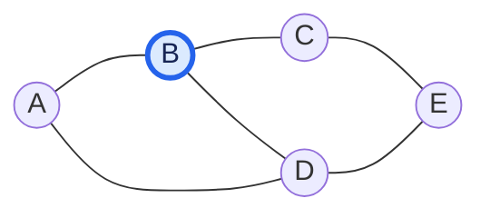

**RISPOSTA DELLO STUDENTE:** «3 archi ... C A e D». **ESITO:** corretta. **SOLUZIONE:** B è adiacente ad A, C, D e il suo grado è 3.

## Esercizio 2 — Grado di D
**DESCRIZIONE.** Sul grafo dell'esercizio 1, calcolare il grado di D.

**RISPOSTA DELLO STUDENTE:** «3». **ESITO:** corretta. **SOLUZIONE:** D è collegato ad A, B ed E, dunque deg(D)=3.

## Esercizio 3 — Strade a senso unico
**DESCRIZIONE.** Scegliere il tipo di grafo adatto a strade percorribili in un solo verso.

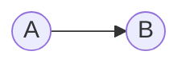

**RISPOSTA DELLO STUDENTE:** «una rete a senso unico ... grafo orientato». **ESITO:** corretta. **SOLUZIONE:** A→B non implica B→A.

## Esercizio 4 — Grado entrante e uscente
**DESCRIZIONE.** Calcolare deg⁻(B) e deg⁺(B).

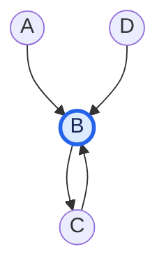

**RISPOSTA DELLO STUDENTE:** «grado entrante 3 e grado uscente 1». **ESITO:** corretta. **SOLUZIONE:** entrano A→B, C→B e D→B; esce B→C.

## Esercizio 5 — Cammini semplici
**DESCRIZIONE.** Individuare tutti i cammini semplici da A a D e le loro lunghezze.

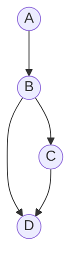

**RISPOSTA DELLO STUDENTE:** «a b d e a b c d». **ESITO:** corretta. **SOLUZIONE:** A→B→D ha lunghezza 2; A→B→C→D ha lunghezza 3. Per *cammini* qui si intendono cammini semplici; senza tale restrizione, in generale possono esistere percorsi con ripetizioni.

## Esercizio 6 — Eliminazione di un ciclo
**DESCRIZIONE.** Eliminando l'arco C→A, rimane un ciclo?

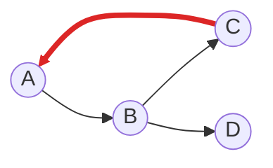

**RISPOSTA DELLO STUDENTE:** «no, non avrebbe ancora un ciclo». **ESITO:** corretta nel grafo proposto. **SOLUZIONE:** l'eliminazione di C→A rompe il ciclo A→B→C→A, senza altri cicli presenti.

## Esercizio 7 — Grafo pesato
**DESCRIZIONE.** Confrontare i percorsi A—B e A—C—B.

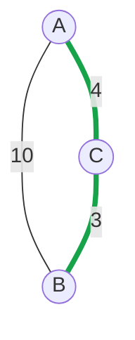

**RISPOSTA DELLO STUDENTE:** «conviene passare per c ... peso 7 ... [diretto] peso 10». **ESITO:** corretta. **SOLUZIONE:** 4+3=7, inferiore a 10.

## Esercizio 8 — Lista di adiacenza
**DESCRIZIONE.** Interpretare `print(grafo["B"])`.

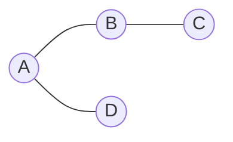

```python
grafo = {"A": ["B", "D"], "B": ["A", "C"], "C": ["B"], "D": ["A"]}
print(grafo["B"])
```

**RISPOSTA DELLO STUDENTE:** `['A', 'C']`. **ESITO:** corretta. **SOLUZIONE:** sono i vicini memorizzati per B.

## Esercizio 9 — Matrice di adiacenza
**DESCRIZIONE.** Determinare il risultato di `matrice[0][2]` e il suo significato.

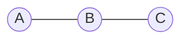

| | A | B | C |
|---|---:|---:|---:|
| A | 0 | 1 | 0 |
| B | 1 | 0 | 1 |
| C | 0 | 1 | 0 |

```python
matrice = [[0, 1, 0], [1, 0, 1], [0, 1, 0]]
print(matrice[0][2])
```

**RISPOSTA DELLO STUDENTE:** «restituisce la posizione 2 della linea 0 quindi 0». **ESITO:** corretta. **SOLUZIONE:** 0 indica assenza di un arco diretto A—C.

## Esercizio 10 — Quale rappresentazione usa meno memoria?
**DESCRIZIONE.** Grafo con 1.000 vertici e solo 2–3 vicini per vertice: matrice o lista?

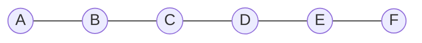

*Illustrazione qualitativa di grafo sparso; non rappresenta tutti i 1.000 vertici.*

**RISPOSTA DELLO STUDENTE:** «La matrice di adiacenza». **ESITO:** errata. **CORREZIONE:** la lista di adiacenza generalmente risparmia memoria: O(V+E) contro O(V²); una matrice da 1.000 vertici contiene 1.000.000 celle.

## Esercizio 11 — Riconoscere un grafo sparso
**DESCRIZIONE.** Grafo con 100 vertici e 120 archi su 4.950 possibili: sparso o denso?

**RISPOSTA DELLO STUDENTE:** «è un grafo sparso perché ha pochi archi rispetto a quelli possibili». **ESITO:** corretta. **SOLUZIONE:** 120/4950 ≈ 2,42%, pochi archi rispetto al massimo.

## Esercizio 12 — Scelta della rappresentazione
**DESCRIZIONE.** Grafo con 10.000 vertici e 15.000 archi: scegliere la rappresentazione che generalmente occupa meno memoria.

**RISPOSTA DELLO STUDENTE:** «Lista di adiacenza perché rappresenta solamente gli effettivi collegamenti». **ESITO:** corretta. **SOLUZIONE:** O(V+E) invece di O(V²), che richiederebbe 100.000.000 celle. La risposta dimostra che l'errore nell'esercizio 10 è stato corretto.

## Esercizio 13 — BFS (APERTO)
**DESCRIZIONE.** Nel grafo non orientato qui sotto, partire da A e visitare i vicini da sinistra verso destra usando BFS. **Qual è l'ordine completo dei vertici visitati?**

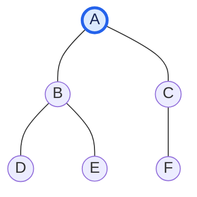

**STATO:** domanda proposta, **nessuna risposta ricevuta**. Non aggiungere la soluzione prima che lo studente tenti l'esercizio.

---

## Esercizio 14 — Che cosa succede aggiungendo un arco a un albero?
**DESCRIZIONE.** Partendo dall'albero con archi A—B, A—C, B—D, B—E, C—F, decidere se aggiungere E—F produce ancora un albero o un ciclo e motivare la risposta.

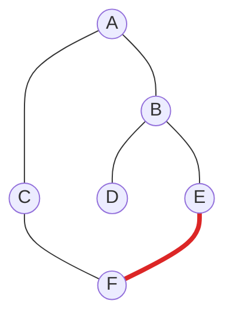

**RISPOSTA DELLO STUDENTE:** «diventerebbe un grafo con un ciclo perché c'è una connessione tra due figli di padri diversi». **ESITO:** corretta nella conclusione, motivazione da precisare. **CORREZIONE:** la causa non è l'avere genitori diversi; in un albero esiste già un solo cammino semplice tra E ed F (E—B—A—C—F). Il nuovo arco E—F lo chiude formando il ciclo E—B—A—C—F—E. Aggiungere un arco tra due vertici diversi di un albero produce esattamente un ciclo.

**COSA HO IMPARATO:** riconoscimento del ciclo quando si aggiunge un arco a un albero; distinzione tra parentela dei nodi e esistenza di un cammino preesistente. **ARGOMENTO D'ESAME:** alberi come grafi connessi e aciclici; cicli.

## COSA HO IMPARATO IN QUESTO ESERCIZIO
Vertici, archi e grado; orientamento; grado entrante/uscente; cammini e cicli; DAG; pesi; lettura di liste e matrici di adiacenza; grafi sparsi/densi e risparmio di memoria. Da consolidare tramite esercizi pratici: BFS, DFS e implementazioni Python.

## ARGOMENTO D'ESAME
Terminologia e rappresentazioni dei grafi; prerequisiti per visite BFS/DFS e algoritmi sui cammini minimi.

## COMPLESSITÀ
Spazio lista di adiacenza O(V+E); spazio matrice O(V²). Le complessità di BFS e DFS non sono ancora state verificate con lo studente.

## PROSSIMO PASSO
Chiedere soltanto la risposta alla domanda 13, una domanda per volta.
