# Grafi — Appunti illustrati

> Lezione del 12 ottobre 2026. Diagrammi Mermaid incorporati: GitHub li visualizza direttamente nel Markdown. Gli esercizi effettivamente svolti sono in [esercizi_guidati.md](esercizi_guidati.md). BFS è stata introdotta, ma la sua visita manuale è ancora da svolgere.

## Indice
1. [Che cos'è un grafo](#1-che-cosè-un-grafo)
2. [Orientati e non orientati](#2-grafi-orientati-e-non-orientati)
3. [Grado di un vertice](#3-grado-di-un-vertice)
4. [Cammini](#4-cammini)
5. [Cicli e DAG](#5-cicli-e-dag)
6. [Grafi pesati](#6-grafi-pesati)
7. [Liste di adiacenza](#7-liste-di-adiacenza)
8. [Matrici di adiacenza](#8-matrici-di-adiacenza)
9. [Grafi sparsi e densi](#9-grafi-sparsi-e-densi)
10. [BFS e DFS: introduzione](#10-bfs-e-dfs-introduzione)
11. [Riepilogo e prossimi passi](#11-riepilogo-e-prossimi-passi)

## 1. Che cos'è un grafo

Un **grafo** è una struttura composta da **vertici** (o nodi) e **archi** (collegamenti). Formalmente: **G = (V, E)**, dove V è l'insieme dei vertici ed E quello degli archi. Può rappresentare reti di computer, città e strade, dipendenze tra attività o relazioni.

Nel grafo seguente V = {A, B, C, D, E}; i collegamenti sono A—B, B—C, A—D, B—D, C—E, D—E.

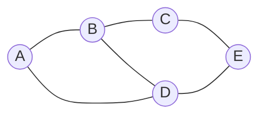

Il vertice B è collegato direttamente ad A, C e D.

## 2. Grafi orientati e non orientati

Un **grafo non orientato** consente di percorrere l'arco in entrambe le direzioni; un **grafo orientato** associa un verso all'arco. Una strada a senso unico richiede quindi un grafo orientato.

| Non orientato | Orientato |
|---|---|
| A—B vale nei due versi | A→B non implica B→A |
| Arco come coppia non ordinata | Arco come coppia ordinata |

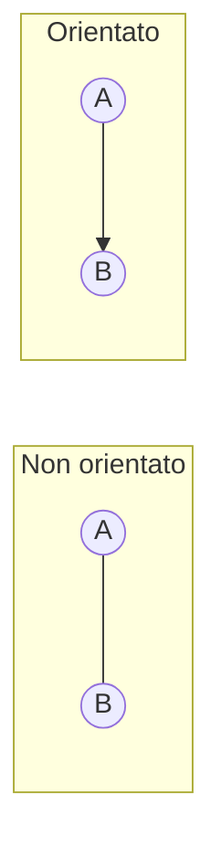

## 3. Grado di un vertice

In un grafo **non orientato**, il grado di un vertice è il numero di archi incidenti (un cappio conta due volte). Nel primo esempio, **deg(B) = 3** e **deg(D) = 3**.

Nel grafo **orientato** distinguiamo:
- **grado entrante** deg⁻(v): archi diretti *verso* v;
- **grado uscente** deg⁺(v): archi che *partono* da v.

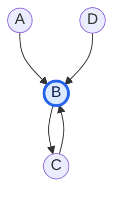

Per B: **deg⁻(B) = 3**, **deg⁺(B) = 1**. Notare che B→C e C→B sono *due archi differenti*.

## 4. Cammini

Un cammino è una sequenza di vertici collegati consecutivamente da archi; in un grafo orientato bisogna seguire le frecce. La **lunghezza di un cammino non pesato** è il numero degli archi. Un **cammino semplice** non ripete vertici.

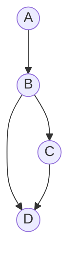

I due **cammini semplici** da A a D sono:
1. **A→B→D**, lunghezza **2**;
2. **A→B→C→D**, lunghezza **3**.

### Evidenziazione del primo cammino

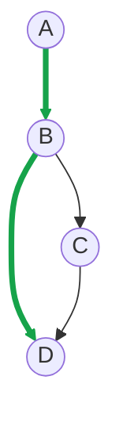

### Evidenziazione del secondo cammino

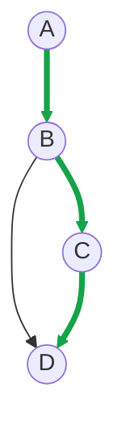

## 5. Cicli e DAG

Un **ciclo diretto** torna al vertice iniziale seguendo il verso degli archi, senza ripetere altri vertici. Un **DAG** (*Directed Acyclic Graph*) è un grafo diretto senza cicli.

### Con ciclo A→B→C→A

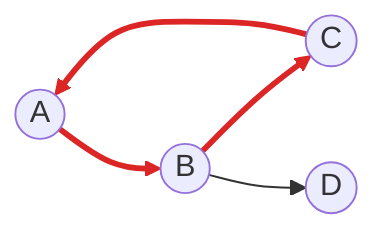

### Dopo la rimozione di C→A: DAG

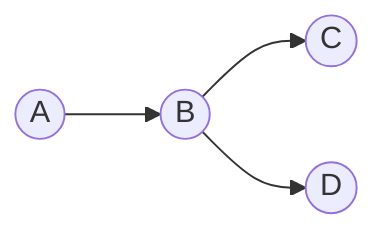

Nel secondo disegno non esiste più un percorso diretto che ritorni al punto di partenza.

## 6. Grafi pesati

Un **peso** associato a un arco può rappresentare distanza, costo, tempo o latenza. Il peso di un percorso è la **somma dei pesi degli archi** attraversati.

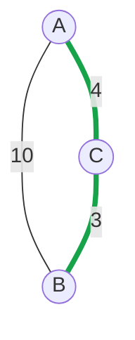

Da A a B:
- diretto: **10**;
- passando da C: **4 + 3 = 7**.

Il percorso attraverso C ha peso minore. Questo anticipa il problema dei **cammini minimi**: in seguito studieremo Dijkstra (con pesi non negativi), Bellman-Ford e altre tecniche.

## 7. Liste di adiacenza

Una **lista di adiacenza** associa a ciascun vertice l'elenco dei propri vicini.

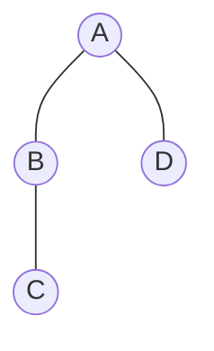

```python
grafo = {
    "A": ["B", "D"],
    "B": ["A", "C"],
    "C": ["B"],
    "D": ["A"],
}

print(grafo["B"])  # ['A', 'C']
```

Le chiavi del dizionario sono i vertici; le liste contengono i vicini. Per grafi non orientati ogni arco è registrato nei due elenchi corrispondenti. La complessità spaziale è **O(V + E)**.

## 8. Matrici di adiacenza

In una **matrice di adiacenza**, righe e colonne rappresentano i vertici. Nel caso semplice non pesato, 1 indica la presenza di un arco e 0 l'assenza.

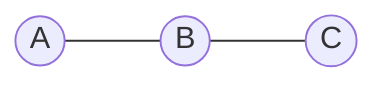

|   | A | B | C |
|---|---:|---:|---:|
| **A** | 0 | 1 | 0 |
| **B** | 1 | 0 | 1 |
| **C** | 0 | 1 | 0 |

```python
matrice = [
    [0, 1, 0],
    [1, 0, 1],
    [0, 1, 0],
]
print(matrice[0][2])  # 0: non esiste arco diretto A-C
```

Gli indici Python iniziano da 0: riga 0 = A, colonna 2 = C. La matrice occupa **O(V²)** spazio anche con pochi archi. Il controllo della presenza di un arco mediante accesso a una cella richiede **O(1)**.

## 9. Grafi sparsi e densi

- **Sparso**: pochi archi rispetto al massimo possibile.
- **Denso**: molti archi rispetto al massimo possibile.
- Per un grafo **semplice, non orientato**, il numero massimo di archi è **V(V−1)/2**. Non esiste una soglia percentuale universale.

### Grafo sparso (6 vertici e 5 archi)

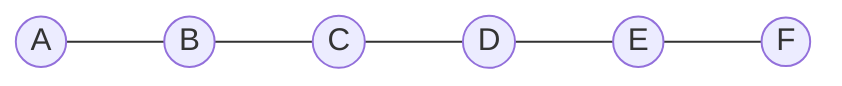

### Grafo denso (5 vertici, tutti collegati tra loro: 10 archi)

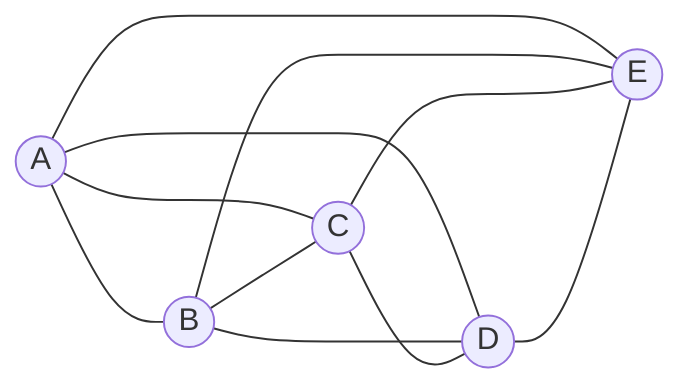

Con **100 vertici**, il massimo è **4.950 archi**; averne **120** significa circa **2,42%**: grafo sparso.

Con **10.000 vertici**, una matrice contiene **100.000.000 celle**, indipendentemente dagli archi presenti. Con soli **15.000 archi**, la lista di adiacenza è normalmente molto più economica in memoria.

| Aspetto | Lista di adiacenza | Matrice di adiacenza |
|---|---|---|
| Memoria | O(V+E) | O(V²) |
| Grafi sparsi | In genere preferibile | Celle inutilizzate |
| Verifica arco | O(grado), con lista standard | O(1) |
| Elenco dei vicini | Diretto | Scansione di una riga, O(V) |

La convenienza effettiva può dipendere dall'implementazione e dalle operazioni più frequenti.

## 10. BFS e DFS: introduzione

- **BFS** (*Breadth-First Search*): visita prima i vertici a distanza minima, misurata in numero di archi; in genere usa una **coda FIFO**.
- **DFS** (*Depth-First Search*): esplora un ramo in profondità prima di tornare indietro; può usare ricorsione o una **pila**.

### Grafo dell'esercizio BFS ancora aperto

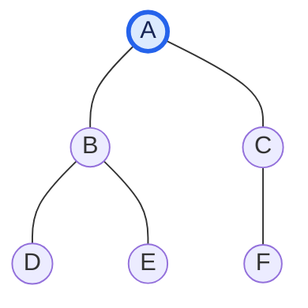

I livelli rispetto ad A sono:
- livello 0: A;
- livello 1: B e C;
- livello 2: D, E e F.

**Attenzione:** questo schema introduce la BFS ma la risposta alla **domanda 13** (ordine completo di visita con i vicini da sinistra a destra) **non è stata ancora fornita dallo studente**. Va proposta senza anticipare la soluzione.

## 11. Riepilogo e prossimi passi

**Acquisito e verificato con risposte:** vertici, archi, gradi, orientamento, cammini semplici, cicli, DAG, pesi, accesso alle rappresentazioni, grafi sparsi e densi, confronto della memoria. L'errore iniziale sulla matrice per grafi sparsi è stato corretto con verifiche successive.

**Da fare:** visita BFS a mano (domanda 13), poi funzionamento della coda, pseudocodice, implementazione Python, DFS e algoritmi avanzati del programma. Non attribuire allo studente implementazioni che non ha scritto.

**Collegamenti:** [Esercizi svolti](esercizi_guidati.md) · [Esempi Python](esempi_grafi.py) · [Indice modulo](README.md) · [Programma](../PROGRAMMA_CORSO.md).
